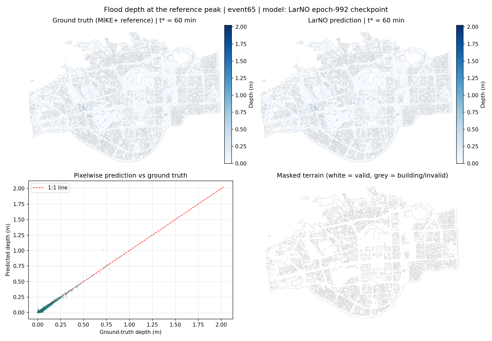

# FloodGuard AI

**Flood risk research prototype using the official pretrained LarNO model (Latent Autoregressive Neural Operator).**

> Research and education only — not a certified flood-warning system. The benchmark results below describe the
> Futian (Shenzhen, China) benchmark only and say nothing about accuracy anywhere else, including Egypt.

## What this is

A fully reproducible Google Colab notebook that runs **real, pretrained flood-depth prediction** using the
official [LarNO](https://github.com/holmescao/LarNO) code, official
[checkpoint](https://huggingface.co/holmescao/LarNO) (`exp_weights.zip`, epoch 992) and the official
[Futian `region1_20m` benchmark](https://huggingface.co/datasets/holmescao/LarNO-dataset) — no reimplemented
or substitute model.

**Paper:** Cao et al., *Large-scale urban flood modeling and zero-shot high-resolution generalization with LarNO*,
Journal of Hydrology (2026) — DOI: [10.1016/j.jhydrol.2026.135686](https://doi.org/10.1016/j.jhydrol.2026.135686)

## Files

| Path | Description |
|---|---|
| `FloodGuard_AI.ipynb` | The complete Colab notebook (executed, with outputs embedded) — sections A–J + Egypt research part |
| `results/report.md` | Auto-generated results summary (checkpoint, hardware, metrics, limitations) |
| `results/test_metrics/` | Official metrics Excel written by the official `test.py` |
| `results/pred_results/` | Raw prediction arrays `(400, 560, 72)` in metres — event65, event66 |
| `results/visualization/` | Official PNG snapshots, peak maps, CSI error maps, animated GIFs |
| `results/figures/` | FloodGuard figures: rainfall hyetograph/snapshots, DEM, prediction vs ground truth, error map, time series |
| `results/logs/` | Official inference log |
| `results/Egypt_data_readiness_checklist.md` | Required data/validation steps before any Egypt experiment |
| `results/environment_report.txt` | Environment snapshot of the verified run |

## Verified results (2 official test events, Tesla T4)

| Event | R² | RMSE (m) | MAE (m) | PeakR² | CSI (3 cm) |
|---|---|---|---|---|---|
| event65 | 0.9936 | 0.0041 | 0.0020 | 0.9863 | 0.846 |
| event66 | 0.9938 | 0.0042 | 0.0020 | 0.9869 | 0.852 |
| Overall | 0.9937 ± 0.0001 | 0.00414 | 0.00201 | 0.9866 | 0.849 |

Metrics produced by the official evaluation pipeline and independently recomputed from the saved arrays
(agreement within 1e-4). Ground truth = MIKE+ hydrodynamic simulations, not field observations.



## Run it in Google Colab

1. Open [Google Colab](https://colab.research.google.com) → **File → Upload notebook** → `FloodGuard_AI.ipynb`.
2. **Runtime → Change runtime type → T4 GPU**.
3. **Runtime → Run all** (~5–10 min: installs, downloads checkpoint + 2 test events, real inference, figures, metrics, ZIP).

At the end, `FloodGuard_AI_Results.zip` (all outputs, ~116 MB) is produced; in Colab it also lands in your Drive
under `MyDrive/FloodGuard_AI/` if the optional Drive cell is enabled.

## Egypt

No Egyptian predictions are produced or implied. See
[`results/Egypt_data_readiness_checklist.md`](results/Egypt_data_readiness_checklist.md) for the required
terrain, rainfall (NASA GPM IMERG), reference-label and validation steps, and the domain gaps vs the
Shenzhen-trained checkpoint.

## Citation

```bibtex
@article{cao2026large,
  title={Large-scale urban flood modeling and zero-shot high-resolution generalization with LarNO},
  author={Cao, Xiaoyan and Yao, Yao and Wang, Zhi and Zhao, Zhangxinyue and Borthwick, Alistair GL and Qin, Huapeng},
  journal={Journal of Hydrology},
  pages={135686},
  year={2026},
  doi={10.1016/j.jhydrol.2026.135686},
  publisher={Elsevier}
}
```
